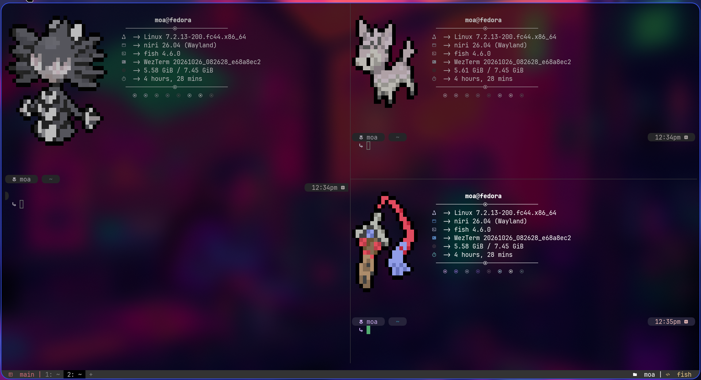

# wezterm

My personal [WezTerm](https://wezfurlong.org/wezterm/) config.

- `wezterm.lua` — everything (theme, tabs, panes, status bar)
- `colors/dank-theme.toml` — custom color scheme

Leader is **ALT + e**.

## Keybindings

| Key | Action |
| --- | --- |
| `LDR c` | new tab |
| `LDR p` / `LDR n` | previous / next tab |
| `LDR 1`–`9` | go to tab by index |
| `LDR w` | tab navigator / split horizontal |
| `LDR ,` | rename tab |
| `LDR .` | move tab mode (`h`/`j` left, `k`/`l` right) |
| `LDR q` | split vertical |
| `LDR ← ↓ ↑ →` | focus pane |
| `LDR Space` | rotate panes |
| `LDR z` | zoom pane |
| `LDR x` | close pane (asks first) |
| `LDR !` | move pane to new tab |
| `LDR r` | resize pane mode (`<` `-` `+` `>`, `Esc`/`Enter` to exit) |
| `LDR s` | workspace launcher |
| `LDR [` | copy mode |
| `LDR :` | command palette |
| `LDR Ctrl+a` | send `Ctrl+a` |

`Esc` or `Enter` exits any key table mode.
